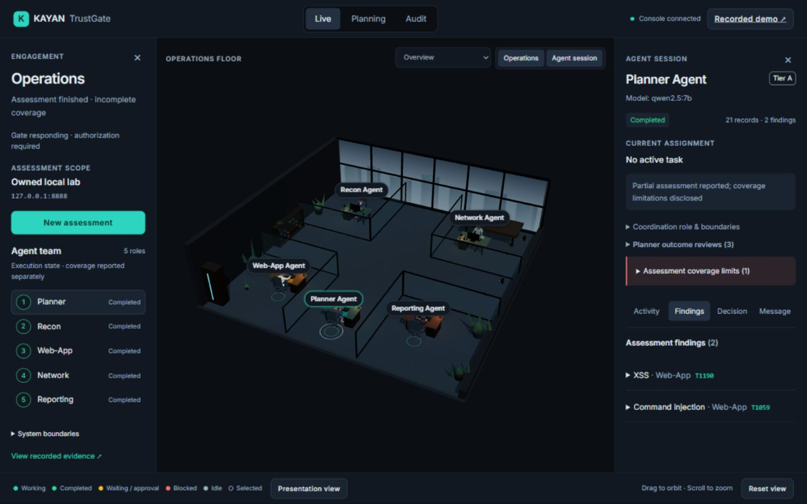
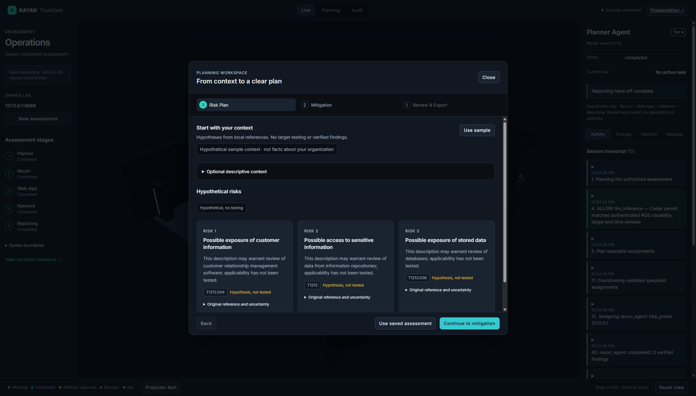
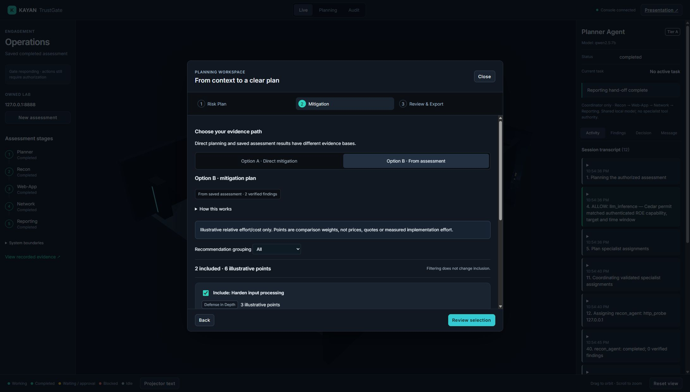
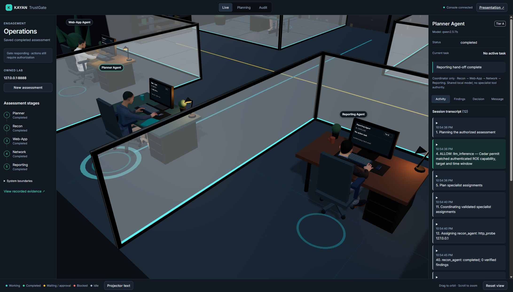
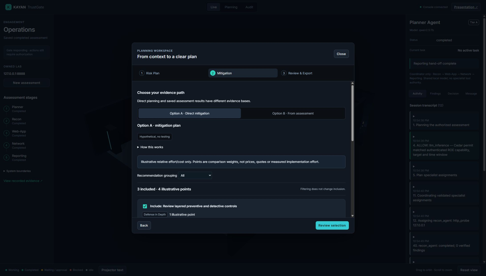

# KAYAN TrustGate

**A governed security-assessment platform with a live 3D operations console.**

KAYAN coordinates a local-model assessment of an owned lab through signed Rules of Engagement and Rust/Cedar authorization. The console makes assignments, decisions, model activity and independently reproduced findings visible. Planner coordinates Recon, Web-App, Network and Reporting; all roles share the local `qwen2.5:7b`. Planner is a coordinator, not a second model or an extra tool executor.



[Project proposal PDF](output/pdf/KAYAN_TrustGate_Proposal.pdf) · [Evidence PDF with video links](output/pdf/KAYAN_Evidence_Presentation.pdf) · [Three-path demonstration](https://drive.google.com/file/d/1cBt1aRcKtT3EulSUwK-y9ayTv1UNfWkJ/view?usp=sharing) · [Recorded live assessment](https://drive.google.com/file/d/1SRUVpJtSssnN1zlT0g4Z_ZI4jXg3xfNb/view?usp=sharing)

The screenshots are actual rendered views captured on 2 November 2026. The videos retain the earlier recorded interface and their original engagement evidence.

## What you can demonstrate

| Path | What happens | Evidence basis |
|---|---|---|
| Phase 1: Risk Plan | Descriptive context is matched against the local ATT&CK/OWASP index. | Hypotheses only; no target access or authorization call. |
| Option A: Direct mitigation | Reporting turns the Risk Plan into a mitigation plan. | Offline recommendations; zero verified findings. |
| Option B: Assessment to mitigation | Planner coordinates the governed specialists, then Reporting synthesizes reproduced findings. A saved completed report can also be reviewed. | Live signed-scope assessment or its explicitly labeled saved evidence. |

Organization context carries **zero policy weight**. Defense in Depth / Zero Trust labels and recommendation selection are presentation features. Effort points are illustrative comparison weights, not prices or measured implementation costs.

### Risk planning



### Mitigation from a completed assessment



<details>
<summary>More screenshots: Planner activity and offline mitigation</summary>

The Planner panel shows its shared model, capability tier, assignment sequence and chronological activity. Findings retain their specialist ownership.



Option A remains visibly hypothetical and performs no live testing.



</details>

## Run the recorded review

Prerequisites: Python, Node.js and Git LFS. Live execution additionally needs the Rust/MSVC build tools and installed Ollama with `qwen2.5:7b`. The verified host uses Windows and Python 3.12.

```powershell
git clone https://github.com/khaled1234kh/kayan
cd kayan
git lfs pull
python -m venv .venv
.\.venv\Scripts\Activate.ps1
python -m pip install -r requirements.txt
npm --prefix console/office ci
.\Start-Kayan.ps1 -RestoreDemo
```

Open **http://127.0.0.1:5173/** for the console or **http://127.0.0.1:5173/review.html** for the recorded presentation. Review is the safe launcher default: it starts the backend and office, without starting an assessment, model inference or Docker.

`-RestoreDemo` loads the original completed `7da73508…` session into a waiting/already-matching backend. It deliberately refuses to overwrite another session. Omit that switch when continuing an already loaded assessment.

## Run a live owned-lab assessment

Start the installed Ollama server in its own terminal and ensure `qwen2.5:7b` is installed. Then, from the activated project terminal:

```powershell
.\Start-Kayan.ps1 -Component All
```

All verifies/reuses the Gate, lab, backend and office; it does not start an assessment. In the console, choose **New assessment**, review the owned-loopback authorization and start it. Each action still requires backend authorization; a connected console or responding Gate grants no authority by itself.

| Component | Source | Port |
|---|---|---:|
| Signed-ROE Rust/Cedar Gate | `trustgate/service/` | 8000 |
| Sessions, operator interaction and planning API | `console/backend/` | 8001 |
| React Three Fiber office | `console/office/` | 5173 |
| Intentionally vulnerable owned lab | `lab/` | 8888 |
| Local model server | Installed Ollama | 11434 |

## Verified results

The final [consolidated profile](eval/reports/checkpoints/final_todo_validation_20261102_v5/results.json) passed **17/17 checks**:

| Check | Result |
|---|---|
| Python | 84 passed; 27 retained deprecation warnings in the main profile |
| Rust | 28 passed, including eight audit regression/edge cases |
| Go | 15 focused boundary tests, 15 config tests and the explicit no-embedding case passed |
| Adversarial authorization | 9/9 passed |
| Frontend | Ten scripts plus TypeScript/production build passed; no oversized-chunk warning |

The final actual local-Qwen engagement, `51bba207-f4eb-4ff5-9228-92566ae06377`, produced **2 findings / 29 allowed / 1 denied**. The deliberate tainted-input DENY is included. Planner stayed active through specialist work, completed after Reporting and dispatched no specialist tools. This demonstrates the bounded lab workflow, not general detection accuracy.

The audit serialization fix preserves old entries and signatures; the publication check verified all **779 journal entries**, including after service restart. The journal remains mutable local storage. Exact failures, fixes, runtime evidence and limits are in [final readiness](docs/DEMO_READY_2026-11-02.md).

To repeat the defined checks against running prerequisites:

```powershell
python -B -m eval.functionality_checkpoint --label YOUR_UNIQUE_LABEL
```

The full profile additionally requires Go and the Rust toolchain; the Python demo itself does not require Go or Docker. It starts no model assessment. A freshly downloaded GitHub copy also passed all 84 Python tests in an isolated environment, plus frontend installation/build and ten scripts. Actual-model acceptance is separate and documented in the readiness report. Test-suite and geometry checks do not substitute for rendered UI acceptance or measured FPS.

## Scope and honest limits

**No grounding improvement was demonstrated. Preserve this failure.** The original regression and later comparisons remain in the evidence; retrieval combines ATT&CK and OWASP without a claimed accuracy advantage. Fine-tuning and a separate helper inference model are documented design substitutions, not completed training experiments.

Python is the primary demo engine. The vendored Go/PentAGI work is a scoped enforcement evaluation, not a completed autonomous runtime replacement. Production identity/isolation, immutable audit storage, development-key hardening and completion-triggered ROE revocation remain disclosed limits. Earlier Windows execution failures are preserved; the final normal build/start succeeded without weakening protections. No universal visual, security or performance guarantee is claimed.

## Project guide

- [Architecture and Red/Blue allocation](docs/ARCHITECTURE.md)
- [TA deliverables mapping](docs/TA_DELIVERABLES_ALIGNMENT.md)
- [Final readiness and exact evidence](docs/DEMO_READY_2026-11-02.md)
- [Canonical handoff](MASTER_HANDOFF.md) and [TODO record](TODO.md)
- [Publication provenance and local recovery history](docs/GITHUB_DELIVERY_2026-11-02.md)

All active source is in this repository. The previous external 3D folder, unrelated Remotion video project and old sibling server are not runtime dependencies. Only clean `main` is published; the original development ancestry and recovery bundle stay local.

## Team

Khaled Mohamed · Youssef Montasser · Ahmed Ali Moustafa Badawi · Mahmoud Ahmed Fathy Ashry · Talal Yousif Norelhuda Elhag

The proposal PDF contains the five confirmed students and their IDs.
