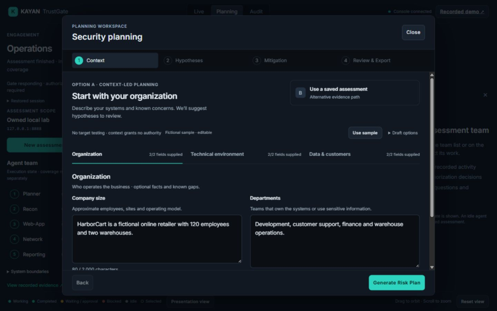

# KAYAN TrustGate

**A governed security-assessment platform with a live 3D operations console.**

KAYAN coordinates a local-model assessment of an owned lab through signed Rules of Engagement and Rust/Cedar authorization. The console makes assignments, decisions, model activity and independently reproduced findings visible. Planner coordinates Recon, Web-App, Network and Reporting; all roles share the local `qwen2.5:7b`. Planner is a coordinator, not a second model or an extra tool executor.


[Project proposal PDF](output/pdf/KAYAN_TrustGate_Proposal.pdf) · [Evidence PDF with video links](output/pdf/KAYAN_Evidence_Presentation.pdf) · [Three-path demonstration](https://drive.google.com/file/d/1cBt1aRcKtT3EulSUwK-y9ayTv1UNfWkJ/view?usp=sharing) · [Recorded live assessment](https://drive.google.com/file/d/1SRUVpJtSssnN1zlT0g4Z_ZI4jXg3xfNb/view?usp=sharing)

The screenshots show the actual 3 November 2026 workspace/office acceptance pass. The videos retain their earlier interface and original engagement evidence.

## What you can demonstrate

| Path | What happens | Evidence basis |
|---|---|---|
| Phase 1: Risk Plan | Authored applicability rules link described technical details to pinned ATT&CK/OWASP references, source excerpts and uncertainty. | Offline hypotheses; context relevance is not severity. No target access or authorization call. |
| Option A: Direct mitigation | Reporting turns the Risk Plan into a mitigation plan. | Offline recommendations; zero verified findings. |
| Option B: Assessment to mitigation | Planner coordinates the governed specialists, then Reporting synthesizes reproduced findings. A saved completed report can also be reviewed. | Live signed-scope assessment or its explicitly labeled saved evidence. |

Organization context carries **zero policy weight**. Defense in Depth / Zero Trust labels and recommendation selection are presentation features. Effort points are illustrative comparison weights, not prices or measured implementation costs.

### Organization profile and planning



The six-field profile preserves full entered descriptions within explicit limits. Preview fictional samples before replacement, review the exact context, then move through **Context → Hypotheses → Mitigation → Review & Export**. Recommendations use bounded authored scenario controls, not model-generated risk judgments. Weak text-only matches are excluded; insufficient context can produce no supported hypotheses. [Before/after evaluation and actual browser/export evidence](docs/PLANNING_AND_COORDINATION_2026-11-03.md).

Context relevance is explicitly separate from severity, likelihood, impact and urgency:


### Mitigation from a completed assessment


<details>
<summary>More screenshots: Planner activity and offline mitigation</summary>

The Planner panel shows its shared model, capability tier, assignment sequence and chronological activity. Findings retain their specialist ownership.


Option A remains visibly hypothetical and performs no live testing.


</details>

## Run the recorded review

Prerequisites: Python, Node.js and Git LFS. Live execution additionally needs the Rust/MSVC build tools and installed Ollama with `qwen2.5:7b`. The verified host uses Windows and Python 3.12.

```powershell
git clone https://github.com/khaled1234kh/kayan
cd kayan
git lfs pull
python -m venv .venv
.\.venv\Scripts\Activate.ps1
python -m pip install -r requirements.txt
npm --prefix console/office ci
.\Start-Kayan.ps1 -RestoreDemo
```

Open **http://127.0.0.1:5173/** for the console or **http://127.0.0.1:5173/review.html** for the recorded presentation. Review is the safe launcher default: it starts the backend and office, without starting an assessment, model inference or Docker.

`-RestoreDemo` loads the original completed `7da73508…` session into a waiting/already-matching backend. It deliberately refuses to overwrite another session. Omit that switch when continuing an already loaded assessment.

## Run a live owned-lab assessment

Start the installed Ollama server in its own terminal and ensure `qwen2.5:7b` is installed. Then, from the activated project terminal:

```powershell
.\Start-Kayan.ps1 -Component All
```

All verifies/reuses the Gate, lab, backend and office; it does not start an assessment. In the console, choose **New assessment**, review the owned-loopback authorization and start it. Each action still requires backend authorization; a connected console or responding Gate grants no authority by itself.

| Component | Source | Port |
|---|---|---:|
| Signed-ROE Rust/Cedar Gate | `trustgate/service/` | 8000 |
| Sessions, operator interaction and planning API | `console/backend/` | 8001 |
| React Three Fiber office | `console/office/` | 5173 |
| Intentionally vulnerable owned lab | `lab/` | 8888 |
| Local model server | Installed Ollama | 11434 |

## Verified results

The [3 November planning/coordination pass](docs/PLANNING_AND_COORDINATION_2026-11-03.md) adds evidence-referenced real-model outcome reviews, bounded next-specialist priorities, attributed observation reuse and exact-context offline planning. Shared local `qwen2.5:7b`, scope and action budgets remain unchanged. Planner has no specialist tool authority and is not a second model. Fixed role order remains; this is not a general dynamic scheduler.

The [current office/functionality checkpoint](eval/reports/checkpoints/ui_cohesion_final_20261103_v3/results.json) passed **17/17 groups**:

| Check | Result |
|---|---|
| Python |156 passed; 48 retained deprecation warnings|
| Rust |28 passed|
| Go |15 focused boundary tests,15 config tests and explicit no-embedding case passed|
| Adversarial authorization |9/9 passed|
| Frontend |Ten scripts,14 transport/reducer checks,TypeScript/production build and unchanged bundle budgets passed|

Final actual-model engagement **b813d8a6-cc6f-4456-a9bc-0929249fd2a4: 2 findings / 30 allowed / 1 denied**, including the deliberate tainted-input denial and excluding ROE load. Planner remained a coordinator, completed last, and passed three outcome reviews; nine executed-action records retain original evidence. Web-App directory traversal is explicitly untested under the unchanged action budget. Whole journal verified 1,247 entries. A prior real route-timeout failure is preserved alongside its delayed-response reproduction and successful correction; no automatic resend or extra authority was added.

The [per-item acceptance record](docs/UI_OFFICE_ACCEPTANCE_2026-11-03.md) covers all 19 UI tasks plus 15 overlapping office requirements: collapsed rails/compact drawers,scope-review assessment modal,coherent planning stages,readable session/audit,contained exterior,wall cutaways,fitted presets,physical picking and true Presentation view. Actual office/profile/setup renders were inspected at six sizes from 1920×1080 to 640×800,with bounded keyboard/reduced-motion/error/export checks. Geometry/build are separate from rendered acceptance. No aesthetic perfection or universal camera/device support is claimed.

Backend restart now automatically restores the selected session's **records only**, with persistent capped-backoff viewer reconnect. It never resumes model/tools/ROE or queued instructions; interrupted runs become visibly failed/blocked. Review/-RestoreDemo retains its original-session overwrite guard. Planning loads on demand; final entry 82,115bytes and all chunks stay under 500 kB without raising budgets. A single matched performance pair establishes no speedup or statistical regression conclusion.

Five earlier fictional offline before/after cases preserve organization-specific controls and honest insufficient/explicit-absence results. This pass rechecked exact six-field A export,sample undo,saved B,filters and production empty/clinic views. These are deterministic authored-rule checks,not general model accuracy or a grounding benefit. Historical proposal/video and failure evidence remain unchanged.

## Scope and honest limits

**No grounding improvement was demonstrated. Preserve this failure.** The original regression and later comparisons remain in the evidence; retrieval combines ATT&CK and OWASP without a claimed accuracy advantage. Fine-tuning and a separate helper inference model are documented design substitutions, not completed training experiments.

Python is the primary demo engine. The vendored Go/PentAGI work is a scoped enforcement evaluation, not a completed autonomous runtime replacement. Production identity/isolation, immutable audit storage, development-key hardening and completion-triggered ROE revocation remain disclosed limits. Earlier Windows execution failures are preserved; the final normal build/start succeeded without weakening protections. No universal visual, security or performance guarantee is claimed.

## Project guide

- [Architecture and Red/Blue allocation](docs/ARCHITECTURE.md)
- [TA deliverables mapping](docs/TA_DELIVERABLES_ALIGNMENT.md)
- [Current UI/office acceptance](docs/UI_OFFICE_ACCEPTANCE_2026-11-03.md)
- [Earlier planning, coordination and browser evidence](docs/PLANNING_AND_COORDINATION_2026-11-03.md)
- [Earlier readiness](docs/DEMO_READY_2026-11-02.md)
- [Canonical handoff](MASTER_HANDOFF.md) and [TODO record](TODO.md)
- [Publication provenance and local recovery history](docs/GITHUB_DELIVERY_2026-11-02.md)

All active source is in this repository. The previous external 3D folder, unrelated Remotion video project and old sibling server are not runtime dependencies. Only clean `main` is published; the original development ancestry and recovery bundle stay local.

## Team

Khaled Mohamed · Youssef Montasser · Ahmed Ali Moustafa Badawi · Mahmoud Ahmed Fathy Ashry · Talal Yousif Norelhuda Elhag

The proposal PDF contains the five confirmed students and their IDs.
