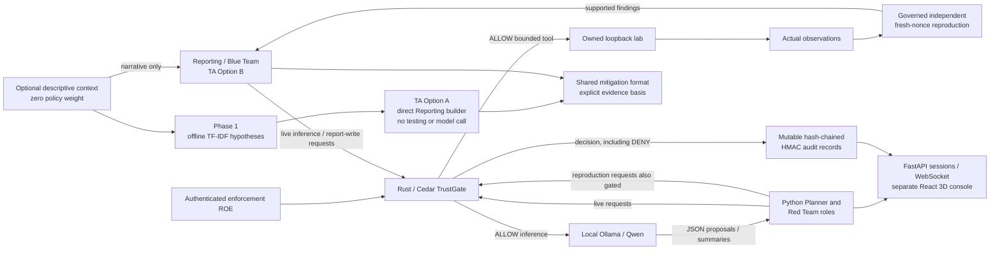

# KAYAN TrustGate — frozen project overview for defense

Prepared from the current architecture, code interfaces and preserved evaluation artifacts on 2026-11-01. No proposal/thesis draft was found among the project files in the bounded filename/heading search; no external draft or independently supplied original TA brief was reviewed. This is the current source-grounded abstract, problem, methodology and diagram, aligned to the user's TA mapping. It is not a claim that an unavailable external proposal has been revised.

## Abstract

KAYAN is a bounded autonomous security-assessment platform that separates agent proposals from execution authority. A Rust/Axum service compiles authenticated Rules of Engagement into Cedar policies and checks live model/tool requests against declared roles, actions, targets, time windows and caller-supplied provenance. A Python engine coordinates Planner, Recon, Web-App, Network and Reporting roles using a shared local Qwen model. The separate 3D console displays actual tasks, transcripts, findings and governance decisions over HTTP/WebSocket. A standalone local-retrieval Risk Plan and direct no-testing mitigation path extend the reporting surface without adding policy authority or target access.

The evaluation preserves both successful boundary behavior and adverse retrieval outcomes. The original grounding-on run produced fewer findings than grounding-off; a later bounded-retry pair produced equal findings and decision counts. A separate signed-menu Go/PentAGI profile demonstrated governed dispatch in a second framework while exposing worker/adapter limitations. These results support a working bounded implementation and scoped enforcement evidence, not general autonomy, production isolation, improved reasoning or universal absence of false authorization. Visual acceptance and the final three-path rehearsal remain explicit delivery gates.

## Problem and project objective

An LLM can propose actions from misleading observations, reference material or malformed task handoffs. Model output and retrieved text should not create execution permission. The project therefore places a separate policy boundary between live proposals and authorized operations, and records the resulting decisions and actual observations so the operator can distinguish proposed, denied, executed and independently reproduced work.

The objective is a defensible local demonstration, not unrestricted testing. Live Python tools are bounded to the owned loopback lab; findings require a second fresh-nonce request with supported evidence. Descriptive company context has zero policy weight. Phase 1 hypotheses and defensive recommendations are visibly separated from tested findings. Mutable audit storage, trusted local callers and incomplete production identity/isolation remain disclosed limitations.

## Methodology

1. Authenticate the enforcement ROE with the existing HMAC scheme and compile its roles/scope/actions/time window into Cedar. Default-deny and forbids remain in the dedicated Rust service. The optional six-field descriptive context stays outside signing/loading and authorization inputs.
2. Coordinate the live Python roles with serialized local Ollama inference. The existing model-architecture Option A means one shared qwen2.5:7b across role contracts; it is distinct from TA Option A below. Model-selected arbitrary shell/URL execution is not provided by the bounded Python tool catalog.
3. Supply pinned skill and ATT&CK/OWASP reference context through local TF-IDF retrieval. Reference context is not training, an executable tool catalog or permission. Compare preserved grounding-off/on runs without deleting the original regression.
4. Gate actual live inference/tool requests and retain audit/transcript references. Publish findings only when the governed runtime supplies supported independent reproduction. Raw XSS reflection does not establish browser execution; nonce reproduction and legacy evidence precision remain separate metrics.
5. Expose actual session/task/transcript updates in the 3D console. Status questions are governed; task-changing instructions wait for a safe boundary. Build/SSR/transport checks and human-rendered acceptance remain separate evidence categories.
6. Map the TA's Red Team to Recon/Web-App/Network and Blue Team to the existing Reporting role. Phase 1 returns hypothetical context matches without a model, target, tool or gate call. TA Option A sends those hypotheses directly to Reporting's deterministic structured builder. Option B sends reproduced live findings into the same mitigation section. Fixed illustrative point weights/grouping tags are presentation metadata, not a pricing engine.

## Architecture diagram

The diagram is a logical view. It does not imply that every permitted operation contacts the lab, that a retrieved hypothesis is a finding, or that displaying an audit record makes its storage immutable. Detailed source boundaries and interfaces are in [ARCHITECTURE.md](ARCHITECTURE.md).

## Recorded evaluation and interpretation

These are the preserved measurements, read during consolidation rather than rerun for this document.

| Evaluation | Findings / allowed / denied | Interpretation |
|---|---|---|
| Original v1, grounding off | 1 / 23 / 1 | 20% findings-based five-label coverage |
| Original v1, grounding on | 0 / 23 / 2 | 0% coverage; regression retained |
| Bounded-retry v2, grounding off | 2 / 29 / 1 | 40% coverage; 2/2 nonce reproduction; 1/2 legacy precision |
| Bounded-retry v2, grounding on | 2 / 29 / 1 | Equal outcome, not demonstrated improvement |
| Scoped Go/PentAGI evaluation | 3 / 19 / 15 | Includes three verifier ALLOWs; Go-only 16 / 15; worker failures retained |

**No grounding improvement was demonstrated. Preserve this failure.** No fine-tuning experiment or training-time winner was measured. The design chose pretrained local inference plus retrieval for compute/project-time reasons. The index already combines ATT&CK and OWASP; no additional combined framework is pending.

Go's five recorded actual terminal dispatches matched the signed menus in the saved profile; this is zero observed unauthorized dispatches relative to those menus, not a universal false-allow proof. Its three flows waited after worker failures and were stopped. Unmapped subtask_patch is a local adapter exclusion. Per-model-call Go authorization and a full Go console/runtime replacement are not claimed.

The TA API fixture returned three hypothetical risks, three Option A recommendations and zero findings; the saved-run Option B view returned two recommendations linked to two previously verified findings. These counts have different evidence bases and do not compare mitigation quality. Recommendations have not been tested for effectiveness. The separate source-controlled TA report records 46 passing Python tests and the build/API/CLI/presentation checks with their limits.

## Delivery boundary

Feature implementation is frozen and the core requirements are implemented within the stated bounds. Legitimate access subsequently became available in the original built-in browser. The twelve-step direct visual observations and corrected discrepancies are recorded in [CLOSURE_EVIDENCE_REVIEW_2026-11-01.md](CLOSURE_EVIDENCE_REVIEW_2026-11-01.md); its original timing gap was rechecked with an actual rendered frame within 916.031 ms of task-start publication. [TA_MEETING_READINESS_2026-11-01.md](TA_MEETING_READINESS_2026-11-01.md) records that bounded observation, current regression results and the saved-report rehearsal. Earlier exact access denials remain historical evidence, not a current blocker. Generic assurances still do not substitute for observations.

FBX re-export and bundle-size cleanup remain deferred under the user's explicit decision to finish frozen delivery requirements only. The small monitor support obstruction was separately corrected and rendered again during acceptance. The final three-path video reuses the original saved `7da73508…` report; it is distinct from the earlier Option B-only video. No fresh live engagement ran during that final recording. The formal six-section submission prose is [TA_PROPOSAL_REPORT.md](TA_PROPOSAL_REPORT.md), with negative grounding outcomes and unfinished requirements preserved.

Review order and exact evidence links: [SUBMISSION_INDEX.md](SUBMISSION_INDEX.md). Filming actions without self-assessing results: [ACCEPTANCE_FILMING_CHECKLIST.md](ACCEPTANCE_FILMING_CHECKLIST.md).
