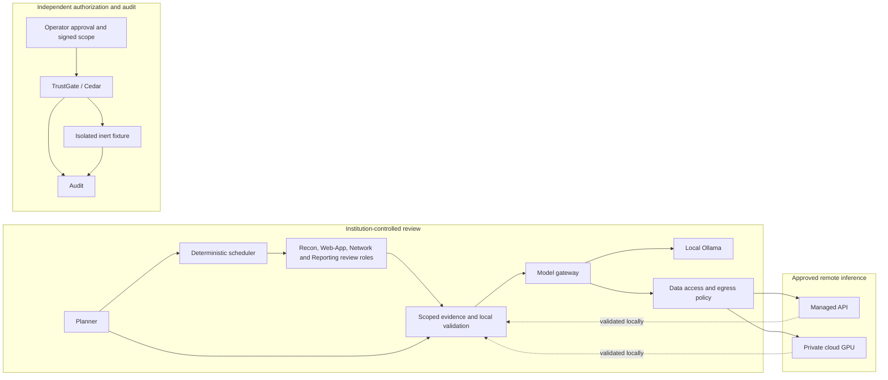

# KAYAN TrustGate research update

The [implementation overview](ARCHITECTURE.md) describes the current application. The research phases used a separate offline defensive evidence-review prototype with frozen records and inert fixtures. The operational baseline still uses local Qwen2.5 7B and independent Rust/Cedar authorization.

## Measured results

| Study | Observed result | Limit |
| --- | --- | --- |
| Operational Planner, November 4 | 24/30 authored coordination cases passed on the first attempt and 26/30 after the existing correction path. Four final failures remain. | Real-model, inference-only evaluation. No specialist tools ran. The score measures the authored contract, with unsupported details found outside the rubric. |
| Phase 1 checkpoint comparison | Five models each completed 80 authored cases. Qwen3 8B led exact passes at 28/80. Granite 4.2 8B led evidence F1 at 0.762. | The exploratory paired interval for their exact-pass difference spans zero. No confirmatory winner has been selected. |
| Phase 2 scheduling | The reports matched in all 24 pairs. Dependency-ready scheduling showed a 0.39% median paired time reduction with one inference slot. | Each schedule won 12 pairs, and the second arm finished faster in all 24. The order effect remains unexplained. |
| Phase 3 ATT&CK mapping | Lexical references raised exact-ID micro-F1 from 0.167 to 0.778 on 32 authored cases. A same-model evidence screen raised it to 0.800 while strict exactness stayed at 25/32. | This measured mapping on reused offline cases. The scorer checked expected whole observation records. Earlier live-lab grounding showed a regression and a later tie. |

The paper revision corrected the benchmark denominator (400 model-case evaluations, 402 inference attempts), the authorization diagram’s caller, and wording about scoring granularity and experimental controls. The published scores and conclusions stayed the same.

## Proposed cloud-ready defensive review

The design compares local inference, managed APIs, private cloud GPU serving, and hybrid routing. A deterministic scheduler checks dependencies. A model gateway routes approved inference requests under budget and data-transfer controls. TrustGate remains independently responsible for the policy decision on any effect. The proposed evaluation uses frozen records and inert effects.

Cloud cost, latency, and production readiness remain unmeasured. The next research gates are independent human annotation and confirmatory model comparison, then isolated Rust/Cedar verification on an approved host. The archived Windows build stopped before the latter test with Application Control error 4551.

## Local paper and evidence

On the consolidated workstation, open `output/packages/KAYAN-TrustGate-Academic/README.md` from the project root. It indexes the original and revised paper, editable source, the full vector diagram, verified ZIPs and SHA-256 sidecars, and the two academic demonstration recordings. These files are kept in Git-ignored local storage. The archive index and reproduction notes describe how to replay saved results offline. Fresh runs of Granite and Qwen3 require obtaining the matching weights again.
