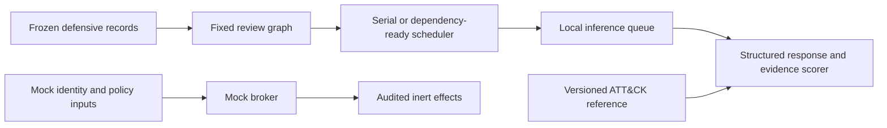

# KAYAN TrustGate benchmark briefing

**Graduation research pilot · 12–13 November 2026**

The strongest result is on ATT&CK evidence mapping. On 32 authored defensive cases, the same local Qwen2.5 7B checkpoint scored **.063 exact-ID micro F1 with no retrieval, .444 with Enterprise TF-IDF, .522 with BM25 and .686 with BM25 plus evidence checks**. The final arm retained 12 true positives, reduced false positives from 14 to 3 relative to unvalidated BM25 and missed eight mappings. No generation arm produced a contract-valid abstention. One blinded AI review agreed on 30 of 32 technique-and-evidence sets. Human adjudication on independently collected records remains pending. [Mapping results](results/grounding-model-qwen-v1/summary.csv) · [Label review](results/grounding-label-review-v1/comparison.json)

## What the team can present

| Question | Evidence and decision |
|---|---|
| Can the Planner reliably order known dependencies? | Qwen2.5 7B met the full contract on 3/16 offline Planner cases. Granite 4.2 8B led at 7/16 and still produced eight invalid orders. A rule-based oracle met it on 16/16 because these cases supply complete rules and dependency inputs. Use deterministic dependency checks and evaluate open-ended planning separately. The historic 24/30 first-attempt and 26/30 corrected scores came from a different test. |
| Does scheduling overlap make work faster? | On four mock graphs, overlap reduced time by 17.75–31.58% where independent work existed. On the same workflow shapes with real one-slot inference, median paired changes were +0.13% for Qwen2.5, −0.09% for Llama, +0.06% for Granite and +0.27% for Qwen3. The time saved in synthetic record preparation was small relative to inference. |
| Should the laptop serve two inferences at once? | Two slots were feasible. In the scheduled experiment the median reduction was 12.89% with one slot tested first and 1.84% when that order was reversed. A separate request-pair test measured slightly lower aggregate throughput and higher request p95 with two slots. Keep one slot as the default. |
| Which checkpoint is the strongest candidate? | Qwen3 led exact passes with 28/80, one ahead of Granite. Granite had the strongest evidence F1 (.762 versus .693) and the best Planner exact count (7/16). Qwen3 had lower aggregate p95 (3.84 s versus 5.04 s) and lower peak GPU use. The exact-pass interval between the two spans zero. These are candidates for further testing on independent records. |
| Does specialization justify the cost? | The initial calibration-selected mix gained three exact held-out cases over shared Llama and lost .064 evidence F1. In a separate calibration workflow test it took 30.79 s per group versus 13.49 s for shared Llama. Eight checkpoint changes consumed 70.73 s in reported model load time. Adding Granite to calibration changed the selected mixture. That mixture gained one exact case over shared Granite in held-out replay, with lower evidence F1. On four separate timed calibration groups it took 40.38 s versus 18.25 s for shared Granite. Keep the shared operational model. |
| Did TrustGate enforcement survive concurrency? | The independent mock broker passed all 19 scenarios with zero unauthorized effects and zero false refusals. A separate 128-graph coverage run matched the terminal-state oracle on all 256 runs. Fresh Cedar build scripts were blocked by Windows Application Control error 4551. Real transport authentication, durable replay and Cedar runtime were outside the verified evidence. |

The cited historical live grounding comparison did not demonstrate improvement. The new gain applies to a controlled offline mapping task with its own label and evidence rules. The v20.1 corpus improved standalone BM25 ranking by one correct assignment, but a separate 64-call model comparison produced identical paired Qwen outputs across v20.0 and v20.1. No model was trained. [Full results](RESULTS.md) · [Method and academic references](PROTOCOL.md)

## Where the experimental controls sit

The scheduler experiment supplies dependencies directly from the fixture. Model outputs go to the scorer, and the mock broker has its own test inputs. Production TrustGate was outside both paths.

## Proposed decision

Keep the existing operational configuration and independent Rust/Cedar authorization. For the defensive prototype, let the model propose review tasks and let deterministic code check dependencies, readiness and completion. Use versioned ATT&CK retrieval with evidence validation. Before presenting a result as a general improvement, repeat it on an independently labeled holdout and verify the real authorization controls on an approved host.
