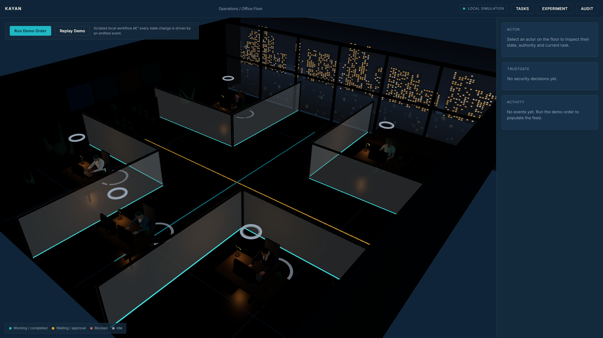
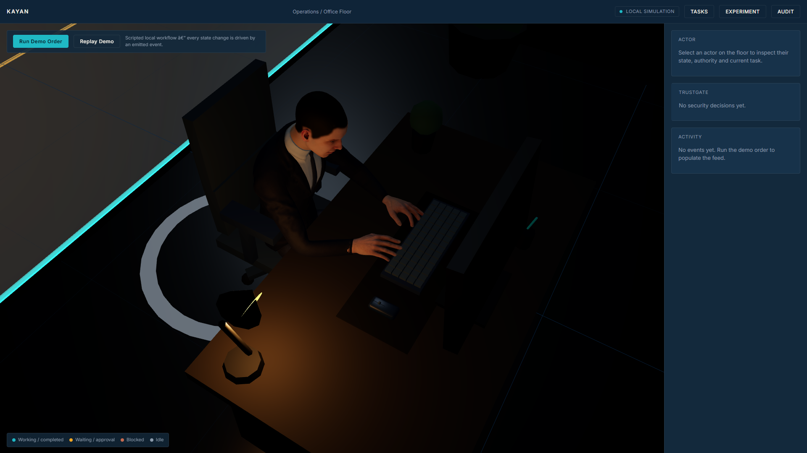
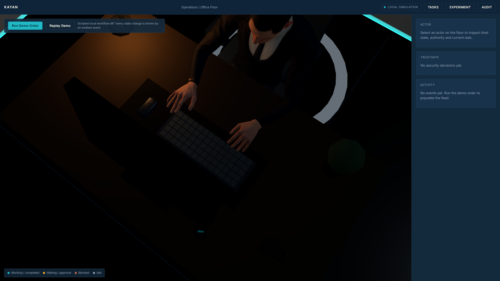
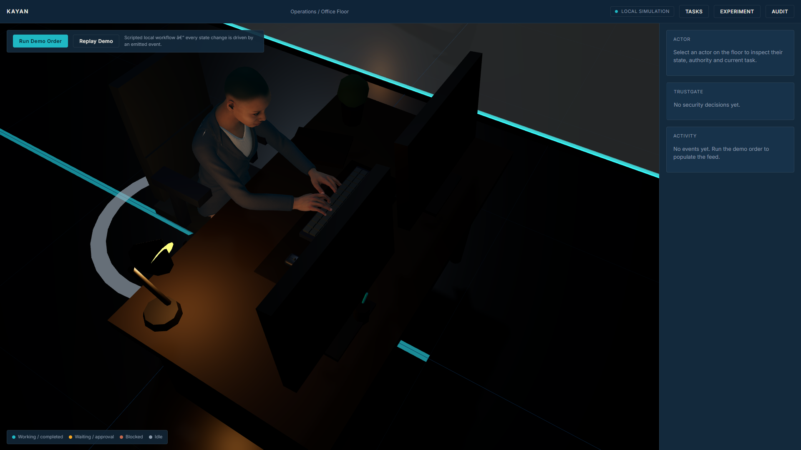

# KAYAN — 3D Office Foundation

Tasks 01–03 of the KAYAN build. A browser-based 3D operations floor that visualizes
the company workforce, actor states, a scripted order workflow, and a TrustGate
enforcement decision.

This app is a **visualization and interaction layer only**. It owns no business
logic. Domain state is *derived* by folding a stream of events through a pure
reducer, so the same event sequence always produces the same result.

```
Workflow (mock)  →  KayanEvent  →  eventReducer  →  Zustand  →  UI / 3D
```

Nothing downstream of the store knows where an event came from.



## Stack

React 18 · TypeScript · Vite · Three.js · React Three Fiber · Drei · Zustand

## Run

```bash
npm install
npm run dev        # http://localhost:5173
```

| Script              | Purpose                                  |
| ------------------- | ---------------------------------------- |
| `npm run dev`       | Vite dev server with HMR                 |
| `npm run typecheck` | `tsc --noEmit` (strict)                  |
| `npm run build`     | typecheck + production build to `dist/`  |
| `npm run preview`   | serve `dist/` on port 4173               |

## Structure

```
src/
  types/index.ts             Actor, ActorState, Task (what the UI renders)
  types/events.ts            KayanEventType, KayanEvent, EVENT_DEFS, KayanEventSource
  security/policyTypes.ts    ActionIntent, AuthorizationContext, PolicyDecision
  security/trustGate.ts      mock policy evaluator + authorizeIntent (entry point)
  state/eventReducer.ts      pure (state, event) -> state; the only business rules
  state/MockEventSource.ts   routes intents through TrustGate, emits events on a timer
  state/useStore.ts          Zustand: actors/tasks/events/lastDecision + emitEvent
  workflow/orderWorkflow.ts  the scripted order, as pure data (no timers, no state)
  data/actors.ts             seed workforce
  data/layout.ts             zones, palette, ActorState -> colour/label maps
  components/office/         floor, grid, zones, walls, furniture, camera + lighting
  components/actors/         actor bodies, desks, state markers
  components/ui/             top bar, demo controls, inspector, TrustGate panel, event feed
  devtools/DebugBridge.tsx   DEV-only store/projection/stats bridge
```

For the office scene itself — workstation rebuild, native typing animation,
derived desk height, and the verification tooling — see
[3D Scene — Operations Floor](#3d-scene--operations-floor).

## Event architecture

**One source of truth for event names:** `EVENT_DEFS` in `src/types/events.ts`.
The reducer, the activity panel and the workflow script all reference the
catalogue, so renaming an event is a single edit.

**Events, never direct state writes.** The workflow engine only emits. The
reducer decides transitions:

| Event | Actor state |
| --- | --- |
| `task_started` | `working` |
| `awaiting_info` | `waiting` |
| `approval_requested` | `awaiting_approval` |
| `blocked` / `policy_denied` | `blocked` |
| `info_provided` | `working` |
| `task_completed` | `completed` (all task participants) |
| `order_received` | resets every seat to `idle`, opens the task |

`plan_proposed`, `plan_validated`, `task_assigned`, `artifact_created` and
`cost_metered` are metadata events: they mutate the task record, not actor state.

The activity panel renders `useStore().events` directly — it is a view over the
stream, with copy supplied in each event's `payload.message` and level/colour
taken from `EVENT_DEFS`.

## TrustGate (mock enforcement)

`src/security/` holds the TrustGate contract and a deterministic local evaluator.
It sits between AI intent and authorized action:

```
Workflow declares an intent
        ↓
MockEventSource.runIntent()  →  authorizeIntent(intent)
        ↓
evaluatePolicy(intent, context)  →  ALLOW | DENY  (+ policy, reason)
        ↓
allow  → normal lifecycle event (task_started)
deny   → policy_denied (decision in payload) → blocked event
        ↓
Event reducer  →  actor state + TrustGate panel
```

The workflow script never states an outcome — an intent step declares *what the
agent wants to do*, and the gate decides. Allow and deny travel the same code
path, so the happy path and the denied path cannot drift apart.

Rules, evaluated in fixed order: explicit prohibition → capability scope →
untrusted origin may not drive private-data access → approval token required.

Demo scenario: AI Operations receives an untrusted supplier instruction and
attempts `customer_data.read` on `customer/4417`. That resource is outside its
capability scope, so the gate denies, the task is blocked, and the workflow
switches to an authorized alternative (`inventory.read`) and completes.

The sidebar panel renders the latest decision lifted from the event stream by the
reducer — there is no separate security channel, so a denial also appears in the
activity feed. Replacing `authorizeIntent` with a backend OPA/Rego decision call
should not require changes anywhere else.

## Actors

| Actor           | Kind | Zone       | Authority                                  |
| --------------- | ---- | ---------- | ------------------------------------------ |
| Nadia Farouk    | human| CEO Office | Accountable owner — final approval         |
| Tarek Mansour   | human| Operations | Scoped access — assigned tasks only        |
| AI Manager      | ai   | Meeting    | Delegated authority — cannot self-grant    |
| AI Sales        | ai   | Sales      | Capability contract — draft_quote only     |
| AI Operations   | ai   | Operations | Capability contract — stock read only      |

States: `idle`, `working`, `waiting`, `awaiting_approval`, `blocked`, `completed`.
Each maps to one restrained accent colour — see the legend in the viewport.

## Demo workflow

**Run Demo Order** plays the scripted order as a sequence of events (order
received → manager plans → plan validated → sales starts → operations starts →
untrusted instruction → TrustGate denies → task blocked → authorized alternative
resumes → employee provides info → quotation → approval requested → CEO reviews
→ CEO approves → order completed), over about 15 seconds. Every visible state
change, including the denial and the recovery, is the result of a `KayanEvent`
being emitted and folded through the reducer.

**Replay Demo** appears in development builds only. It clears current state and
re-emits the previously recorded event sequence at its original cadence, so runs
are reproducible for the experiment work that comes later.

No LLM and no network calls. State is in-memory; reload resets everything.

## Agent collaboration (multi-agent runtime)

`src/agents/` is the collaboration layer. Agents do not flip their own status:
they exchange typed messages and handoffs, and the runtime turns each
interaction into events.

```
Workflow script (collabWorkflow.ts)   — who contacts whom, with what payload
        ↓
MockAgentRuntime                     — sendMessage / delegateTask / createHandoff
                                        acceptHandoff / completeHandoff / receiveMessage
        ↓
KayanEvent                           — agent_message_sent, information_requested,
                                       task_delegated, task_accepted, task_handoff, …
        ↓
Event reducer                        — derives actor state, inbox/outbox, transcripts
        ↓
Zustand → 3D + UI
```

- **`agentProfiles.ts`** — typed `AgentProfile` per seat (objective,
  responsibilities, capabilities, restrictions). The single source of identity:
  `src/data/actors.ts` derives actor name/role/kind/authority from these, so a
  role is never described twice. Capabilities are descriptive metadata, *not* an
  authorization mechanism.
- **`agentMessages.ts`** — typed `AgentMessage` (`task | question | response |
  handoff | approval_request | approval_response`) with `replyToMessageId`,
  structured `context`, and a delivery flag.
- **`handoffs.ts`** — typed `AgentHandoff`: objective, context, constraints,
  expected output, status `sent | accepted | completed | rejected`. This is the
  object a real agent runtime will populate.
- **`agentRuntime.ts`** — `MockAgentRuntime` owns collaboration behaviour. It has
  no knowledge of actor states, the reducer, Zustand or the scene; it emits events
  and stops.

Per-agent `inbox` / `outbox` / `activeHandoff` / `currentTaskId` and the visible
transcript are **derived by the reducer from the message objects carried in the
event stream**, so a replay reproduces collaboration state exactly.

The demo order is now a genuine chain:
Manager → Sales (delegation) → Sales → Operations (inventory request) →
Operations → Sales (42 available of 50 required) → Sales → Human Employee
(fulfilment decision) → Human → Sales → Sales → Manager → Manager → CEO
(approval request) → CEO → Manager (approved) → order completed.

`HandoffBeams` draws a short-lived line between two desks while a message is
being delivered. It is driven exclusively by real `AgentMessage` objects and
fades out — no connection is ever invented and nothing accumulates.

## Audit and evidence view

`src/audit/` derives a durable evidence surface from state that already exists —
the event stream, message log, handoffs and actor list. There is no audit
database, no separate security log and no cached evidence: clear the history and
the audit view correctly shows nothing, which is what makes it replay-safe.

- **`derive.ts`** — pure projections. `buildAuditRows` reverses a *copy* of the
  event list into chronological order (the store keeps events newest-first for the
  activity feed). `buildSecurityEvidence` walks the stream once per
  `policy_denied` and assembles the causal chain — intent → decision →
  `policy_denied` → `blocked` → authorized recovery — locating everything by typed
  references (event ids, message ids, intent fields), never by text matching.
- **`exporters.ts`** — `buildAuditJson` and `buildAuditCsv` are pure functions of
  the current run snapshot. They never regenerate the workflow, never mutate state
  and never invent timestamps. `downloadText` only triggers the browser download.
- **Filters** derive from `EVENT_DEFS[...].category`, added to the catalogue for
  exactly this purpose. No parallel arrays per bucket.
- The **evidence chain is navigable**: each chain step is a button that selects the
  corresponding event in the table, so `policy_denied → blocked → recovery` is
  reachable by click.

Note on payload keys: the runtime stores the typed message under
`payload.agentMessage` and the human headline under `payload.message`, because a
draft's own `message` context field would otherwise overwrite the object.

## Experiment harness

`src/experiments/` runs the same order scenario repeatedly under two conditions and
records what actually happened. It generates **no claims** — only descriptive
measurements.

**Conditions.** `baseline` treats the simulated malicious action as allowed and
records a `policy_violation`; `enforced` consults the real evaluator and produces
`policy_denied` → `blocked` → authorized recovery. Nothing is accessed in either
mode: baseline records that an unauthorized action *would have* proceeded.

**One workflow, two modes.** The single experimental variable lives in
`WorkflowSession`, which wraps the policy layer only:

```
COLLAB_WORKFLOW  →  WorkflowSession.execute(step)
                        └─ policy mode ─┬─ enforced → authorizeIntent()
                                        └─ baseline → simulatedAllow()
```

`MockEventSource` (live demo) and `runComparison` (harness) both drive that same
session class, so the demo and the experiment cannot drift apart.

**Timing.** The harness does **not** sleep between steps. Each step advances a
logical clock by the same `after` delay the live workflow uses, so measured
durations are the workflow's real logical timings rather than an artefact of
scheduling. Nothing is sped up or slowed to flatter the results. Interval metrics
(`order_start_to_completion`, `instruction_received_to_policy_decision`,
`policy_denial_to_blocked`, `blocked_to_authorized_recovery`,
`authorized_recovery_to_completion`) are computed from the events' timestamps.

In backend mode an event's `timestamp` is **real UTC**, and the logical position
arrives separately as `clockOffsetMs` (`null` for events outside a workflow run).
The interval metrics are measured on whichever clock the events actually share, so
the real-time feed and reproducible timings never contaminate each other. In mock
mode there is no offset and the harness's own logical timestamps are used.

Metrics are derived in `experimentMetrics.ts` from the events each run emitted —
event/message/handoff counts, policy decisions, denials, violations, blocked
events, recoveries, completion and final state. Aggregates in `summarise()` are
descriptive only; the prototype has no statistical machinery and makes no
security-effectiveness claim.

Every run retains its event history, so clicking a run row in the experiment view
opens the existing Audit view for that run.

## Event source: local mock or backend WebSocket

`FastApiEventSource` is already implemented, so there is nothing left to swap.
The store takes its events from exactly one source, selected at startup. Both feed
the same `emitEvent` -> reducer path, so the UI cannot tell them apart.

| Mode | Switch | Source | Needs a backend? |
| --- | --- | --- | --- |
| Mock (default) | unset, or `VITE_KAYAN_EVENT_SOURCE=mock` | `MockEventSource` | no |
| Backend | `VITE_KAYAN_EVENT_SOURCE=backend` | `FastApiEventSource` (WebSocket) | yes |

```bash
# local prototype (default, no backend needed)
npm run dev

# backend mode
cp .env.backend.example .env.local
npm run dev
```

Vite only exposes `VITE_`-prefixed variables, hence the prefix. Backend mode reads
`VITE_KAYAN_API_URL` (default `http://127.0.0.1:8000`) and `VITE_KAYAN_STREAM`
(default `main`).

`src/transport/FastApiEventSource.ts` implements the existing `KayanEventSource`
interface, so it is a pure transport:

- connects, receives, reconnects, deduplicates, tracks the resume cursor
- **does not** touch Zustand, decide actor state, run TrustGate, create tasks, or
  send commands — inbound frames are never sent, the bridge is read-only
- duplicate suppression happens before the reducer: an event is accepted once,
  keyed by event id, and any sequence at or below the cursor is ignored
- on an unexpected close it reconnects with bounded exponential backoff and
  resumes via `afterSequence`, so a short disconnect loses nothing

The frontend event contract is unchanged (`id`, `type`, `timestamp` in epoch
milliseconds, `actorId`, `taskId`, `payload`). `sequence` and `streamId` are
additive backend fields; `targetId` and `runId` are read and dropped rather than
widening the client contract.

In backend mode the top-bar indicator distinguishes backend connected /
connecting / reconnecting / disconnected / error, and reads "Local simulation" in
mock mode.

Because the backend is read-only, **Run Demo Order** re-reads the stream from the
beginning (a resync) instead of starting a workflow. `history()` and the dev
replay control behave as before.

### Requesting work (backend mode)

In backend mode **Run Demo Order** sends one command instead of running anything
locally:

```json
{"kind":"command","command":"request_order","requestId":"...","orderId":"1042"}
```

The backend runtime then decides everything — which agent works next, messages,
handoffs, the TrustGate verdict, task transitions — persists every step, and
pushes the resulting events back over the same socket. The browser only asks for
work and watches.

The reply is a protocol acknowledgement (`command_ack`), not the business result:
the result is the event stream. `subscribeCommand()` exposes it for a status
indicator. A command requested before the socket is open is queued and delivered
on connect; each command carries a fresh `requestId`, which the backend uses to
stay idempotent.

Mock mode is unchanged: the button runs the local `MockEventSource` workflow.

### Experiments in backend mode

`Run Comparison` sends one command instead of running anything locally:

```json
{"kind":"command","command":"run_comparison","requestId":"...","orderId":"1042","runsPerCondition":10}
```

The backend executes both conditions through the same runtime, persists every
trial, and pushes the resulting events over the same socket. The acknowledgement
carries an `experimentId` and means *accepted*, not *finished* — the view then
polls `GET /api/experiments/{id}` and distinguishes submitted / running /
completed / partially failed / failed. Status is persisted, so reloading and
reopening the view recovers from the backend rather than from browser state.

Every number the comparison table shows comes from backend-owned trial records;
the frontend formats them and never computes a security outcome. Selecting a trial
loads that trial's events from `GET /api/experiments/runs/{runId}/events`, so its
audit evidence is isolated from every other trial. Exports reuse the existing
JSON/CSV builders over the persisted records.

Mock mode still runs the local harness exactly as before.

### Checks

```bash
npm run check:transport   # transport unit checks (fake socket, injected timers)
npm run check:mock        # mock-mode regression: the scripted order still runs
npm run check:e2e         # live bridge against a running backend
npm run check:command     # backend mode: send request_order, observe the run
npm run check:experiment  # backend mode: run_comparison, results, per-trial audit
```

`check:e2e` and `check:command` need PostgreSQL,
`python -m app.scripts.init_db --demo` in `../server`,
`ENABLE_DEV_ENDPOINTS=true`, and uvicorn listening on port 8000. Together they
prove historical replay, live delivery, the replay/live handover,
multiple-client independence, reconnect-with-resume, and a full backend-driven
order with the TrustGate denial, collaboration and audit evidence.

## Notes

- Camera is inspection-only: orbit, pan, zoom. Polar angle is clamped so the
  operator cannot go under the floor; distance is clamped to 7–34 units.
- The `DebugBridge` is gated behind `import.meta.env.DEV` and is absent from
  production builds.

## 3D Scene — Operations Floor

The `kayan-3d/` subpackage renders a three.js / React Three Fiber scene of the
fictional KAYAN office. Five Mixamo-based actors sit at individual workstations
on a 2×2+1 grid, each running the native sitting-typing animation.



### What the scene contains

- **Five workstations** — CEO, Employee, AI Manager, AI Sales, AI Operations —
  each with a real desk model (slab top, 3-drawer pedestal, matte legs),
  monitor, keyboard, mouse, mat, and desk props (plant, mug, notebook, pen
  holder, lamp).
- **Frosted glass partitions** between pods with cyan base LEDs.
- **Floor LED cross** — cyan Z-axis, warm X-axis — through the central aisle.
  The cyan arm is a deeper teal than the partition LEDs so the two read as
  separate features.
- **Glass curtain wall** with a procedurally generated night city backdrop.
- **Cinematic lighting** — ambient 0.35, cool directional from the glazing,
  warm point lights on each desk lamp.



### Architecture notes for future work

- **Desk height** `DESK_TOP_Y = 0.6325` is DERIVED, not guessed. It comes from
  the animation's measured fingertip positions via `scripts/probe-fingertips.mjs`.
  If the animation changes, re-run that probe and update `src/data/layout.ts`.
- **Arm animation is native.** The clip named `mixamo.com` in each FBX IS the
  typing animation. "mixamo.com" is Mixamo's export convention, not a
  description of the clip's content. There is no separate "typing" clip — an
  earlier pass read the name literally, hand-authored a pose to replace an
  animation that already worked, and stripped the arm tracks out of the clip.
- **No ARM_POSE, no IK, no arm-track stripping.** The mixer drives the arms
  directly. Do not re-introduce any of those.
- **No zone floor tints.** The floor is intentionally bare dark concrete,
  matching the reference. See the `ZONES` comment in `src/data/layout.ts` — the
  data is retained but not rendered.

### Verification tooling

All under `scripts/`:

- `probe-fingertips.mjs` — prints fingertip world positions per actor at a given
  time. Used to derive desk height.
- `probe-clips.mjs` — prints animation clips per FBX.
- `camera-search.mjs` — solver for a camera that fits required points. How the
  presentation preset was found.
- `verify-decor.mjs` / `verify-positions.mjs` — AABB collision and position
  checks.
- `calibrate-arms.mjs` — legacy pose calibrator (kept for reference; not used
  with the native clip).

Every geometry number in this scene was verified by one of these tools. If you
change geometry, re-run the relevant probe.



### Future work

- Monitor screens should display the live KAYAN agent session once the
  session-overlay pipeline exists. Currently dark idle screens. See the TODO in
  `src/components/actors/Monitor.tsx`.